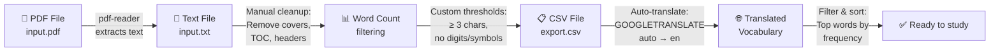

# Foreign Language Learning Accelerator

> **Extract vocabulary from any PDF in a Latin-script language and build a personalized, frequency-ranked word list** — then auto-translate it with Google Sheets.

Language acquisition is most effective when focused on words you actually encounter. This tool automates the extraction of high-frequency vocabulary from any PDF document (books, articles, textbooks) in Latin-script languages, giving you a curated word list ranked by usage. Combined with Google Sheets translation, it becomes a zero-config language learning pipeline.

## Features

- **PDF-to-text extraction** — Parses multi-page PDFs using `pdf-reader` and extracts raw text content
- **Word frequency analysis** — Tokenizes text, normalizes case, and counts occurrence frequencies
- **Smart filtering** — Automatically removes noise: words ≤2 characters, numbers, and tokens with special characters
- **CSV export** — Produces a ready-to-import frequency table (`Word, Count`)
- **Google Sheets integration** — One-liner workflow to auto-translate every word using `GOOGLETRANSLATE()` and filter results
- **Zero NLP dependencies** — Pure Ruby with no language models, stemming, or heavy dependencies required
- **Fully local** — No cloud APIs for extraction; only Google Sheets requires an internet connection for translation

## How It Works



**Output:** A ranked list of the most frequently occurring words in your document, along with their English translations — exactly what you need to focus your study session.

## Requirements

- Ruby ≥ 2.7.2
- A PDF document in a Latin-script language (English, Spanish, French, German, etc.)

## Installation

```bash
git clone https://github.com/realstorypro/language-accelerator.git
cd language-accelerator
bundle install
```

## Usage

### Step 1 — Extract text from your PDF

Place your PDF in the project root and rename it to `input.pdf`. Then run:

```bash
ruby convert.rb
```

This produces `input.txt` with the raw extracted text from all pages.

### Step 2 — Clean up (optional but recommended)

If the PDF has covers, table of contents, headers, or footers, open `input.txt` and remove the lines you want excluded from the frequency analysis.

### Step 3 — Generate the frequency list

```bash
ruby frequency.rb
```

This produces `export.csv` with columns: `Word, Count` — words ranked by frequency of occurrence.

### Step 4 — Translate with Google Sheets

1. Open Google Sheets → **File → Import → Upload** → choose `export.csv`
2. Add a header row above the imported data (e.g., *Word* in A1, *Frequency* in B1)
3. In cell C2, enter:

   ```
   =PROPER(GOOGLETRANSLATE(A2,"auto","en"))
   ```

4. Drag the formula down to fill all rows
5. In cell D2, enter:

   ```
   =A2<>C2
   ```

6. Drag the formula down to filter out words Google couldn't translate (these return the original text)
7. Apply a filter: **Data → Create a filter**
8. In the *Successful Translation* column (D), uncheck `FALSE` — this keeps only translated words
9. In the *Frequency* column (B), sort **Z → A** and exclude entries below your desired threshold (e.g., less than 10 occurrences)

**Done** — you now have a curated vocabulary list of the most important words in your document, with translations, ordered by frequency.

## Word Frequency Pipeline Details

The `frequency.rb` script processes text through these filtering stages:

| Filter | Rule | Purpose |
|--------|------|---------|
| Minimum length | ≥ 3 characters | Removes short function words and noise |
| Numeric check | Excludes digits (0-9) | Removes dates, numbers, identifiers |
| Special characters | Alphanumeric only | Strips punctuation and non-word tokens |
| Case normalization | Lowercase internally, capitalized output | Ensures "The" and "the" are counted together |

**Note:** This tool does not perform stemming, lemmatization, or stop-word removal. Word forms are counted independently (e.g., "run", "running", "runs" are separate entries). For more advanced NLP processing, consider preprocessing the text or post-processing the CSV output.

## Known Limitations

- **Latin scripts only** — Non-Latin scripts (Cyrillic, Arabic, Chinese, Japanese, etc.) are not supported
- **No stemming** — Different inflections of the same word are counted separately
- **Hardcoded filenames** — Scripts expect `input.pdf` / `input.txt` / `export.csv` in the project root
- **No stop-word list** — Common words like "the", "and", "is" may appear in results (filter them in Google Sheets)

## License

This project is licensed under the terms of the MIT License.
